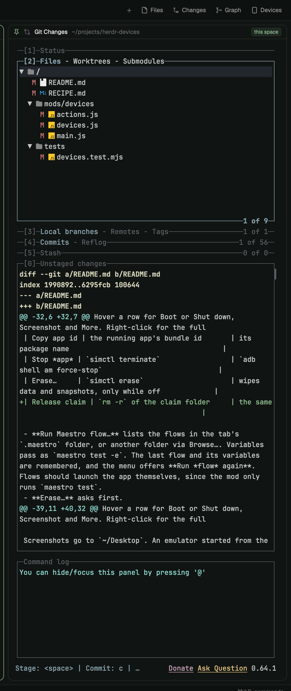

# herdr-pins

A pinned terminal pane for [Herdr](https://herdr.dev). Pin a terminal to a space,
a machine or everywhere; the pane shows the one pinned for the space you are in.
The everyday use: lazygit in every repo's space.



## Install

```sh
git clone https://github.com/ernestjsf/herdr-pins
cd herdr-pins
node setup.mjs --key cmd-alt-o
```

Setup copies the mod into `~/.config/herdr-app/mods/`, clones your current
layout to `my-<name>` if it is one of Herdr's, puts the pins column under the
tab area and binds the key to Pin…. Options: `--layout <name>`, `--height <px>`
(360), `--place bottom|top|right|left`, `--dry-run`. Run it again after a
`git pull`.

## Use

- Press your key, or click the floating pin button, for **Pin…**: start lazygit
  or a shell here, pin an open terminal, or manage your pins. Each row has
  **Space**, **Machine** and **All**. Everything works from the keyboard; the
  footer lists the keys.
- A space pin beats a machine pin, which beats an everywhere pin. With nothing
  pinned the column folds to a sliver.
- Pinning a terminal moves it out of its tab into the column. Unpin gives it a
  tab back.
- Hover the header for **Pin…**, **Move…** and **Unpin**. Move… puts the column
  under, over, left or right of the tab area.
- **Add a command…** adds your own starter (`npm run dev`); **x** removes one.

Commands for your own keys: `pins.pick`, `pins.pin`, `pins.unpin`, `pins.focus`,
`pins.add`, `pins.move`, `pins.move:<bottom|top|right|left>`.

## Notes

- The mod rewrites one `terminal` value in your layout file when the space
  changes, so use a personal layout.
- After a core restart a kept program is a plain shell until you click
  **Restart** in the header.
- Don't bind `layout.toggle:pins`: Herdr's layout save drops hidden nodes.
- Built on Herdr 0.1.11, macOS. Details, pixels and pitfalls: [RECIPE.md](RECIPE.md).

## Development

`node --test tests/`, stdlib only. MIT; icons after [Lucide](https://lucide.dev).
