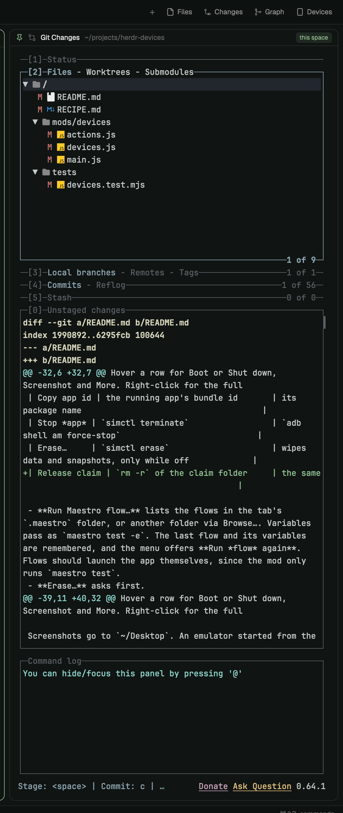

# Pins

A pinned terminal pane for a personal Herdr layout. A pin ties a terminal to one
space, one machine or everywhere; the pane shows the terminal pinned for the
space you are in and follows as spaces change. The everyday use is lazygit pinned
to each repo's space, so git for that repo is always in the same place. The mod is
the pane's 28px header plus a floating pin button; the terminal is a plain layout
block whose address the mod rewrites in the layout file.




## What you see

A column in the layout, under the tab area by default (the `main` block and the
column in a column with an 8px gap), or beside it (a row). 360px tall when under or
over the tabs, 360px wide beside them; `background`, radius 10, 1px `border`,
`accent` border while the focus is inside. Top to bottom:

- **Header**, 28px, the mod. One row, 10px side padding, 8px gaps, 12px type, on
  `background`:
  - a 13px pin icon, `accent` when something is pinned here, else `dim`;
  - nothing pinned: `Nothing pinned here` in `dim`, truncated;
  - pinned: the program's icon at 14px from Herdr's program table (its `svg` tinted
    `dim` when `tint`, else its `image`), the program's name (the live terminal's
    program name, else the pin's name) medium weight in `foreground`, at most 220px,
    truncated; the terminal's live folder (`~` for home, `~/…` under it) in `dim`,
    filling the row, truncated; a scope tag 18px tall, 6px side padding, radius 5,
    `accent` at 12% (`accent` + `1f`) behind 10.5px medium `accent` text: `this
    space`, `this machine` or `everywhere`;
  - a pinned terminal that has ended: the name in `dim` and `t7 has ended` where
    the folder goes;
  - a kept program that came back as a plain shell after a core restart: a
    **Restart** button (refresh icon);
  - a 1px `border` line under the header, 2px `accent` while the pinned terminal
    has the focus (Herdr draws no focus border on a layout terminal block);
  - under the pointer only, at the right: **Pin…** (pin icon), **Move…** (move
    icon), and **Unpin** (pin-off icon) when something is pinned. Header buttons
    are 20px tall, 6px side padding, 4px gap, radius 5, 12px icon and 11px label in
    `muted`; `hover` behind and `foreground` under the pointer.
- **The terminal**: the rest of the column, a layout block showing one terminal.
  Never hidden and never 0px (see Watch out).
- **The fold**, while nothing live is pinned for the current space. Default, a
  **sliver**: the column 8px, the header 7px, the block 1px with no terminal in it;
  the header draws only its `background`. With Herdr's shared `pins.fold` set to
  `"header"` it folds to the **header** instead: the column 29px, the header 28px
  as above (`Nothing pinned here`, Pin… and Move… under the pointer), the block
  1px. A pin whose terminal has ended keeps the header too, for `t7 has ended` and
  Unpin. Unfolding puts the header back to 28px, the block to the rest, and the
  column to its open size (the size it was last dragged to, else the file's).
- **Beside the tabs** the header fold is a 29px-wide strip: only the pin icon,
  centered; a click on it opens Pin…. The sliver is 8px wide and draws nothing.
- **The pin button**: a floating block over the tab area, bottom right by default;
  Herdr draws its frame and people drag it where they like. While no pin shows for
  the current space it is a 24px square with a 14px pin icon, `dim`, `accent` under
  the pointer, radius 6; a click opens Pin… as a centered dialog. While a pin
  shows it draws nothing and no frame shows.

**The Move… popup** is 160 × 130 at the pointer, on `popover`, 5px padding, 12.8px
type: four 30px rows, **Bottom**, **Top**, **Right**, **Left**, each a 13px Lucide
panel icon in `muted` and the label in `foreground`, radius 7, `hover` under the
pointer.

**The picker** (Pin…) is a 480px popup at the pointer, or a centered dialog when
opened from a key or the button; its height is 174px + 30px per row, at most 480px;
on `popover`, 5px padding, 12.8px type:

- A 28px title line, 8px left padding, 11px `dim`: `Pin in <space name>: for this
  space, this machine, or all` (`Starting…` while a Start runs), and a close button
  (x icon, 12px, radius 4, `hover` under the pointer).
- An 18px line under it, 8px left padding, 11px `dim`: `Shows the space pin, else
  the machine pin, else the everywhere pin.`
- Three sections, each under a 24px heading (11px semibold `dim`, 8px left
  padding), scrolling past the popup's height. Rows are 30px, 8px side padding, 8px
  gaps, radius 7, `hover` behind the highlighted row and under the pointer:
  - **Start new**: one row per starter (lazygit and a shell until the list is
    changed): `Start <label> here` (`Start a shell here` for the shell), a 13px
    play icon in `muted`, then the space's current folder at 11px `dim`. The
    highlighted or hovered starter shows a × (11px x icon, `dim`, radius 4) before
    its scope buttons. Last, **Add a command…** with a 13px plus icon, no folder
    and no scope buttons.
  - **Pin an open terminal**: **Pin this pane · <tab> · <name>** for the terminal
    that had the focus when the picker opened, unless it is the one pinned here;
    then one row per other terminal pane in the space's tabs, in tab order,
    `<tab name> · <name>`: its program icon at 14px (an empty 14px slot when none),
    the name as the pane header names it (an agent's or shell's program name,
    else the title, else `shell`), the label at most 170px in `foreground`, its
    live folder at 11px `dim`, and its address (`t65`) at 11px `dim` at the end.
  - **Pins**: every pin, space pins in space order (a closed space's after them),
    then machine pins, then everywhere's. A 13px pin icon, `accent` for the pin
    showing now and `dim` for the rest; a tag like the header's (at most 120px):
    the space's name (`closed space` when it is gone), the machine's name or
    `this computer`, or `everywhere`; the program (at most 120px) in
    `foreground`; the folder at 11px `dim`; `ended` at 11px `dim` when its
    terminal is not live; the address at 11px `dim`; a × when highlighted or
    hovered. No scope buttons. With no pins, one `dim` row: `No pins yet`.
  - At the right of every Start and open-terminal row, three buttons, each its key
    in `dim` then its word, 4px apart: **⏎ Space**, **m Machine**, **a All**:
    20px tall, 6px side padding, radius 5, 1px `border`, 11px `muted`; `selected`
    behind and `foreground` text under the pointer.
- A 46px footer, 1px `border` above, 8px side and 6px top padding, 11px `dim`: key
  caps, each a chip (15px tall, 3px side padding, radius 3, 1px `border`, 10.5px
  `dim`) with its word 3px after it, in groups 10px apart that wrap to a second row
  (4px between rows): [↑][↓] choose, [⏎] space, [m] machine, [a] all, [u] unpin,
  [g] go, [b][t][r][l] move, [n] new, [x] remove, [esc] close.

**Add a command** is a 420 × 214 dialog on `popover`, 18px padding, drawn like
Herdr's own prompt: the title, `Esc` at 11px `dim`, a `Command` label, a 36px input
(accent border while focused, focused on open), the hint `Starts in the space's
folder, split on spaces: htop, npm run dev`, then **Cancel** and **Add**.


## How it behaves

**Pins** are a list in Herdr's shared state (`pins.list`). Each has the terminal's
address (`t7`, or `machine/t7` on another machine), a scope (space, machine or
all), the space's id, the machine (null for this computer), the space's folder
(display only), the program a Start ran (`["lazygit"]`; null for a shell or a
picked terminal), a name, and whether its pane was moved in.

**Which pin shows** in a space: the space pin whose space id is this space's; else
the machine pin whose machine is this space's (null is this computer); else an
everywhere pin. The first in list order wins within a kind. Two spaces in the same
folder are two places with their own pins; a space closed and made again is a new
space.

**One pin per scope and target**: pinning to a space that already has a space pin
replaces it in place (the same for a machine, and for everywhere); otherwise the
pin is appended.

**Showing it**: on every render (Herdr re-renders on space and focus changes) the
header works out what the block should show: the matched pin's address if that
terminal is live, else nothing. Only when that differs from what it last asked for:

- nothing: resize the column, header and block to the fold's sizes, then write an
  empty address into the block, so no live terminal is squeezed to 1px;
- an address: read the shown layout's file, replace the one `terminal` value inside
  the block with the header's block id, and write it back only if it changed. A
  refused write (the file changed in between) reads again and retries once. Only
  when this unfolds the column (nothing was showing, or this is the first render)
  are the header, block and column resized to their open sizes. One address for
  another writes the address and resizes nothing, so a dragged size stays. If the
  wanted address changed meanwhile, the older task stops before writing.

Nothing else in the file is touched: no reformatting, no reordering. The window
reloads the edited layout by itself within a second. Nothing is ever hidden with
`layout.hide` (see Watch out); only an old fold found hidden is shown once.

**The open size** is the one kept in shared `pins.size` per layout and orientation
(`my-main:column` under or over the tabs, `my-main:row` beside them), else the
column's `size.px` in the layout file (240 when it has none, or none above 28px).
Before folding, the column's dragged size is read (from the live layout when it
differs from the file, else from Herdr's clicks in `layouts/.state/<layout>.json`,
read only) and kept; a folded size of 29px or less never counts. While open, each
render also keeps a size that differs from the file's. Switching between two
spaces that both show a pin never resizes.

**The header**: a click on the row focuses the terminal block when the pinned
terminal is live. Pin… opens the picker for the current space. Unpin removes the
matched pin. Neither ends any terminal.

**Moving a pane in**: pinning a terminal that has a pane always moves it: the pane
leaves its tab (a lone pane's tab closes) and the terminal shows in the column
only. When the pane is the only pane of the space's only tab, parking it would
close the space, so the mod first opens a shell tab in the space's live folder and
waits up to 2s (polling every 100ms) for the space to have two tabs; if it never
does, the pin is stored without moving, the pane stays, and a toast says `The pane
stays in its tab`. Then Herdr's `terminal.park` removes the pane; since park turns
core keep off, the mod polls `hc get` (every 300ms, at most 3s) until keep is off
and runs `hc keep <address>` again (`machine/t9` works as is). When a moved pin goes
(Unpin, or replaced by a pin for the same scope and target) and no other pin shows
that terminal, a live terminal gets a pane back: a new tab in the current space
(`terminal.keep` with place `tab`). Start rows never had a pane.

**Repair**: Herdr's own layout save can drop the folded block and leave the header
loose, and can unwrap main's right panel (see Watch out). On start and on every
read for a swap, before anything else, the mod puts both back: the pins column
around the header where it stands (360px, the terminal block moved back in when it
survived elsewhere, else empty), the pin button on the tab block when gone (never a
second one), and main's `panel` column around a loose `panel-body`. When that
changed the tree it writes the file as 2-space JSON and toasts `Pins column repaired
after a Herdr layout save` or `Right panel repaired after a Herdr layout save`.

**Moving the column**: Move… takes the `pins` node out (a `main-column` or
`main-row` wrapper left with one child is replaced by it) and wraps the block
showing the active tab in a column (gap 8; Bottom: pins after, Top: before) or a
row (gap 8; Right: after, Left: before). The node is kept whole, its `size.px`
included (a height in a column, a width in a row). The whole file is rewritten as
2-space JSON, retrying once on a refused write; nothing happens when it is already
there; a toast when the file has no pins column or tab block. The place is also kept
in shared `pins.place`. The fold's sizes survive a move: they belong to the ids.

**Restart**: after a core restart a kept terminal comes back as a plain shell with
the same address. When the pin has a program and the live terminal's foreground
program differs from it by file name (`/opt/homebrew/bin/lazygit` matches
`lazygit`), the header offers Restart, which types the pin's command into that
shell (`hc send`).

**Start rows** run the program as a kept terminal in the space's current folder
(its first tab pane's live folder, else the space's folder): `hc run --bg --keep
--no-parent --outlive-parent --no-notify --name <name> --cwd <folder> [--on
<machine>] --json [-- <argv…>]`; no argv for the shell (hc starts that machine's
shell). The name is `pin-<starter label>-<folder's last part>-<4 characters of the
time in base 36>`, lowercased, other characters as `-`, at most 32 characters.
With `--on`, core 0.1.15 and later print the address already prefixed
(`omarchy/t10`; older cores printed it bare); the mod adds `<machine>/` only when
there is no `/`. A failed start toasts `Couldn't start it` with hc's error and
pins nothing. The popup closes after a pick. Nothing runs by itself: only a Start
row or Restart starts a program.

**The picker's keys** (the whole chord, so cmd-m is not m): ↑/↓ move the highlight
over the rows, wrapping, headings skipped; Enter pins the highlighted row to this
space, **m** to this machine, **a** everywhere; **u** unpins the current match;
**g** closes and focuses the pinned terminal; **b t r l** move the column and
close; **n** opens Add a command; **x** removes the highlighted starter, or the
highlighted pin (as Unpin does, giving a moved pane back); Esc closes. On Add a
command… Enter opens the dialog and the scope keys do nothing. On a pin row Enter
closes and, for a space pin whose space is open, selects that space; **m** and
**a** do nothing. On `No pins yet` nothing does. The highlight starts on Pin this
pane, else the first row. A click on a row is Enter on it; a scope button or × is
that key on its row. In Move…, ↑/↓ move a `hover` highlight (Bottom first), Enter
moves the column there, **b t r l** move it directly, Esc closes.

**Starters** live in shared `pins.starters` as `[{ "label": "lazygit", "argv":
["lazygit"] }, { "label": "shell", "argv": null }]` until changed. Add a command
splits the text on whitespace (no quoting) and names the starter after the first
word without its path (`npm run dev` becomes **Start npm here**); a starter with
the same argv is not added twice; × or **x** removes every starter with that argv,
the defaults included. Enter in the dialog saves, closes it and opens the picker
again for the same space and terminal; Esc or Cancel closes it.

**Keys** are the person's, in `keys.json`; the mod binds none. The `keys.json` here
binds one, `cmd-alt-o` to `pins.pick`, in `global`; merge it under
`layout:<name>` instead to keep it to one layout. The commands, delivered to the
header: `pins.pick` opens the picker; `pins.pin` pins the focused terminal to this
space (moving its pane in as above); `pins.unpin` removes the current match;
`pins.focus` toggles between a pane and the pinned terminal (Herdr's own pane keys
never leave a layout terminal block, so this is the way back without the mouse);
`pins.add` opens Add a command; `pins.move` opens Move…; `pins.move:bottom`,
`:top`, `:right`, `:left` move the column directly. There is no hide or toggle
command (see Watch out).


## Built from

- `mods/pins/mod.json`: `{ "place": "none", "title": "Pins" }`. It docks nowhere
  by itself; the layout places it.
- `mods/pins/main.js`: one `View` with four roles by props. The header (`{ block:
  "pins-terminal", column: "pins" }`, the block it drives and the column it folds;
  the header finds its own block id as the column's child showing this mod), the
  picker (`picker: true`, with `space` and `terminal`), Move… (`mover: true`) and
  Add a command (`starter: true`, with `space` and `terminal`; `InputState` and
  `Input` from `gpui-base` as Herdr's `prompt` mod uses them, focused on open and
  again after 600ms). The pin button is the same mod with `{ button: true }`.
  Helpers copied from Herdr's shipped mods: `place(space)` from `menu`, the folder
  and program-icon helpers from `pane`. Popups open with `openOverlay({ mod:
  "pins", kind: "popup" | "dialog", props })`; the picker's keys come through
  `on_key_down` on its focus handle, read as `e.keystroke`; commands arrive in
  `nextCommand()` of the header copy only.
- `mods/pins/pins.js`, pure, no herdr import: `matchPin(pins, space)`,
  `upsertPin(pins, pin)`, `replacedPin(pins, pin)`, `paneBack(pin, pins)`,
  `blockTerminal(text, blockId)`, `replaceBlockTerminal(text, blockId, address)`
  (one pass over the text tracking strings and open objects, whatever the key
  order; the same text when the block is missing or already shows the address),
  `startArgs({ folder, machine, argv, name })`, `terminalName(what, folder,
  suffix)`, `startedAddress(address, machine)`, `needsRestart(pin, term)`,
  `pickerAction(key, { at, count })`, `pinRows(pins, spaces, terminals, current)`,
  `DEFAULT_STARTERS`, `starterFromText(text)`, `addStarter(list, starter)`,
  `removeStarter(list, starter)`, `foldSizes(fold)`, `draggedSize({ layoutPx,
  filePx, statePx })`, `sizeKey(layout, row)`, `parentOf(node, id)`,
  `pinsPlace(tree)`, `movePinsColumn(tree, where)`, `pinsColumn(height)`,
  `insertPinsColumn(tree, { height, place })`, `PINS_BUTTON`,
  `addPinsButton(tree)`, `repairPinsColumn(tree)`, `PANEL`, `repairPanel(tree)`,
  `isShipped(name)`, `addKey(keys, section, chord, command)`.
- From `herdr`: `spaces()`, `focused()`, `panes()`, `terminals()` (`state`,
  `program.name`, `foreground.cwd`, `foreground.argv`), `layout()`, `theme()`,
  `home()`, `appHome()`, `props()`, `shared(key)` and `setShared(key, value)`,
  `readTextFile` and `writeTextFile(path, text, expected)` on
  `<appHome>/layouts/<layout>.json`, `openOverlay`, `closeOverlay`,
  `nextCommand`, `notify` (the toasts), `hc(args)` for herdr-core, and `run` with
  `layout.resize`, `layout.show` (an old hidden fold only), `pane.focus`,
  `terminal.park`, `terminal.keep`, `tab.new` and `space.select`.
- Programs it runs, all through `hc`: `hc run` (Start rows), `hc get` and `hc
  keep` (moving a pane in), `hc send` (Restart). Nothing reaches the network.
- The layout column, which the person's layout must hold (a personal layout: a
  clone of a shipped one; shipped layouts are replaced on every start):

  ```json
  { "id": "main-column", "type": "column", "gap": 8, "children": [
    { "id": "main", "type": "block", "content": { "tab": "active", "...": "as before" },
      "floating": [{ "id": "pins-button", "content": { "mod": "pins", "props": { "button": true } },
                     "edge": "bottom", "align": "end" }] },
    { "id": "pins", "type": "column", "size": { "px": 360 }, "min": 8, "max": 700,
      "background": "background", "radius": 10, "border": { "width": 1, "color": "border" },
      "focus": { "border": { "width": 1, "color": "accent" } },
      "children": [
        { "id": "pins-header", "type": "block", "size": { "px": 28 },
          "content": { "mod": "pins", "props": { "block": "pins-terminal" } } },
        { "id": "pins-terminal", "type": "block", "content": { "terminal": "" } }
      ] }
  ] }
  ```

- `setup.mjs` at the repo root (Node, stdlib only: `node setup.mjs [--layout
  <name>] [--height <px>] [--place bottom|top|right|left] [--key <chord>]
  [--dry-run]`) does the install, since Herdr's `place` auto-dock docks nothing on
  a shipped layout and wraps the whole window root on a personal one. Home is
  `$HERDR_APP_HOME`, else `~/.config/herdr-app`. It copies `mods/pins` to
  `<home>/mods/pins` (files overwritten; Herdr's own `jsconfig.json` and
  `gpui-kit.d.ts` kept; a symlink there is replaced by a copy); takes the layout
  from `--layout`, else `shared.json`'s `layout`, else `main`, and clones a shipped
  one (`main`, `terminals`, `win98`) as `my-<name>` with `layout.clone`, waiting up
  to 5s for the file; repairs the column and the right panel when needed; adds the
  column above with `insertPinsColumn` and moves it to `--place` when there is no
  node with id `pins` (no tab block: fail), after backing the file up to
  `<name>.json.before-pins`; writes 2-space JSON; `layout.switch` when the window is
  elsewhere; with `--key`, adds the chord under `layout:<name>` with `addKey`, only
  if the chord is bound in no section, then waits 1.5s and reverts if `keys.error`
  appears. `--dry-run` prints the plan and writes nothing.
- `keys.json` at the repo root: the one key above.
- `mods/pins/icons/`: Lucide `pin`, `pin-off`, `play`, `plus`, `refresh`, `x`,
  `move`, `panel-bottom`, `panel-top`, `panel-right`, `panel-left`, with
  `LICENSE-lucide.txt`.
- `tests/pins.test.mjs` and `tests/setup.test.mjs` (node:test) on
  `tests/fixtures/layout.json` (a `main` clone with the column), `main.json` (the
  shipped `main`), `broken.json` (`my-main` as Herdr's save left it, the header
  loose in `main-row`) and `panel-unwrapped.json`.


## Watch out

- Built on Herdr 0.1.11 with herdr-core 0.1.16, on macOS.
- Herdr's own save of a layout file drops every node that is hidden by a click
  **or sized 0px**, then unwraps each container left with one child. Seen twice on
  `my-main`: once with the block hidden, once (00:23 on 2 Nov 2026) with it folded
  to 0px. Each time the terminal block was dropped, the column unwrapped into the
  loose header, and main's own `panel` column (one child, `panel-body`) unwrapped
  too, after which the tab bar's Files/Changes toggle can't hide the panel. Hence
  the fold never hides anything and never goes below 1px, and the repair puts the
  panel wrapper back as main's own `{ "id": "panel", "type": "column", "hidden":
  true, "size": { "px": 368 }, "min": 280, "max": 900 }`. For the same reason the
  README tells people not to bind `layout.toggle:pins`, and there is no hide
  command.
- An empty address draws Herdr's placeholder card in the block; at 1px it does not
  show. That is why the block is resized to 1px and not only the column.
- `layout.resize` is a click, kept in `layouts/.state/`, not in the file. The
  column's `min` must allow 8px or the fold stops at the minimum.
- Never `layout.set`. In Herdr 0.1.11 it drops nodes from the tree and then keeps
  rewriting the layout file from its memory copy until the window restarts.
  Editing the file is the supported path.
- Herdr has no command to swap one terminal in a layout, hence the file edit. Use a
  personal layout and expect that one `terminal` value to change in version
  control if layouts are kept there. A move rewrites the whole file, so a
  hand-formatted layout loses its formatting.
- Icons don't paint when `mods/pins` is a symlink to a folder outside
  `~/.config/herdr-app`, and in 0.1.11 the mod does not hot-reload through one
  either. Copy it.
- The mod runtime has no `structuredClone`; trees are copied with a JSON round
  trip.
- `<mod>.<command>` reaches shown copies only: a hidden column's header gets no
  key commands, so a toggle that hid the column could never show it again.
- A copy that isn't drawn doesn't render: with the screen locked or the window
  hidden nothing swaps until it draws again (timers and `nextCommand` still run).
- A popup's tasks end when it closes: the picker awaits the start and the pin
  before closing itself.
- `hc run --name` must be unique among live terminals, hence the time suffix.
- The space's folder from `spaces()` is where its new terminals start, not where
  its shell is now; Start rows use the live folder of its first pane.
- After a core restart a kept program is a plain shell until Restart is clicked;
  its original command is never run on its own.
- Move… only places the column beside or under or over the tab area; anywhere else
  is a hand edit. Folded beside the tabs with nothing pinned, the strip offers Pin…
  only; Move… needs a pin showing or `pins.move:<where>`.
- Terminals on another machine (`omarchy/t9`) can be pinned; the block draws them
  like local ones.


## Done when

- `node --test tests/` passes: the match's priorities and list order, a space pin
  by id only, machine null against a name, one pin per scope and target, the
  address swap in the fixture (only that line; identical text when equal or
  missing; a mod block has none), several terminal blocks with the id after the
  content, braces and escaped quotes in strings, `hc run` arguments (here, `--on`,
  the shell), terminal names, Restart, the pin a pin replaces and when a pane comes
  back, the column moved to all four places (round trips, the same tree when
  already there, every other node intact), the picker's key mapping, starters
  from text and the list's add and remove, `addKey` (adds, refuses a chord bound
  in any section, keeps the rest), the repair on `broken.json` (the column back
  under `main-row`, nothing else changed; a whole tree untouched; a surviving
  block moved in once), the Pins rows (order, labels, `ended`, the one showing, an
  empty list), the fold's sizes (sliver, header, never 0px), the pin button (added
  on insert, kept by every move, put back by the repair, never twice), which size
  a fold keeps, and the panel repair on `panel-unwrapped.json`.
- `herdr-app check ~/.config/herdr-app/mods/pins` passes and `herdr-app status`
  shows `"errors": []` on the layout with the column.
- In a space with no pin the column is an 8px sliver and the pin button floats at
  the bottom right of the tab area. With shared `pins.fold` set to `"header"` the
  column is its 28px header, `Nothing pinned here`.
- Pin… → Start lazygit here → Space: `hc ls` shows a live `pin-lazygit-…` terminal
  in that folder, the layout file differs from before in that one `terminal`
  value, the pane shows lazygit under a header naming it with `this space`, and
  the pin button is gone. Another space folds the column; back, lazygit again.
- A terminal pinned with All shows in every space without its own pin; a space pin
  still wins in its space.
- `herdr-app do pins.pin` pins the focused terminal to this space; `pins.unpin`
  brings back what showed before.
- In a tab with two panes, `pins.pin` on one: it leaves the tab, the pins block
  shows it tagged `this space`, `hc get` says `keep: true`. `pins.unpin`: it is a
  tab of its own in the current space.
- A lone pane in a space with two tabs: `pins.pin` closes its tab. The lone pane
  of a space's only tab: the space gets a new shell tab and stays; the pane moves.
- `herdr-app do pins.pick` shows the three sections, Pin this pane highlighted,
  the order line and the key-cap footer; `pins.add` shows Add a command with the
  input focused.
- `node setup.mjs --key cmd-alt-o` adds that one line under `layout:<name>` and
  nothing else (`diff` the file); run again, it says the chord is bound;
  `keys.error` is absent.
- `pins.move:right` puts the column beside the tab area at 360px wide;
  `pins.move:bottom` puts it back and the layout file is as before (key order of
  the wrapper aside). Folded on the right it is an 8px sliver, and with `pins.fold`
  `"header"` a 29px strip with the pin icon.
- Drag the column taller, go to a space without a pin and back: it opens at the
  dragged size.
- `node setup.mjs --layout terminals --place right` on a fresh clone puts the
  column right of the tab area.
